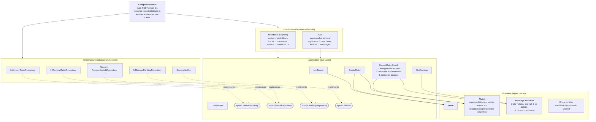
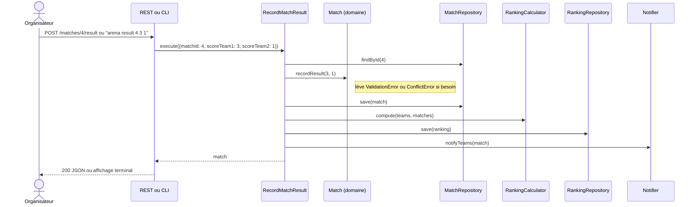

# Architecture cible — Clean Architecture

Contraintes traitées : **C — Indépendance technologique** et **D — Diversification des interfaces**.

## 1. Limites de l'architecture actuelle

| Contrainte | Limite constatée dans l'existant |
| --- | --- |
| C | Les règles métier (validation des équipes et des scores, passage à `completed`, calcul des points, tri du classement) sont écrites directement dans les handlers Express de `server.js`. Ils lisent et modifient le tableau en mémoire de `data.js`. Changer de base de données ou de framework web oblige à réécrire le métier. |
| D | Le seul point d'entrée est HTTP et la logique métier vit dans les routes. Ajouter une interface en ligne de commande obligerait à copier cette logique. |

## 2. Schéma des composants

Les flèches pleines indiquent une dépendance (« appelle » ou « utilise »). Les flèches pointillées indiquent qu'un adaptateur **implémente** un port. Toutes les dépendances pointent vers le centre : le domaine ne dépend de rien.

## 3. Responsabilités

| Couche | Composant | Responsabilité | Dépend de |
| --- | --- | --- | --- |
| Domaine | `Team`, `Match` | Entités et invariants métier (équipes distinctes, scores valides, un match terminé ne change plus) | rien |
| Domaine | `RankingCalculator` | Calcule le classement à partir des équipes et des matchs terminés | rien |
| Domaine | Erreurs métier | `ValidationError`, `NotFoundError`, `ConflictError`, sans aucune notion de code HTTP | rien |
| Application | Use cases | Orchestrent un scénario métier en utilisant les ports | Domaine, ports |
| Application | Ports | Interfaces vers l'extérieur : `TeamRepository`, `MatchRepository`, `RankingRepository`, `Notifier` | Domaine |
| Infrastructure | Repositories en mémoire, `ConsoleNotifier` | Implémentent les ports. Seule cette partie change si l'on passe à une autre persistance (**C**) | Ports |
| Interfaces | API REST (Express) | Traduit HTTP ↔ use cases. Seule cette partie change si l'on change de framework web (**C**) | Use cases |
| Interfaces | CLI | Second point d'entrée qui appelle les **mêmes** use cases, sans dupliquer le métier (**D**) | Use cases |
| Composition root | `main` REST / `main` CLI | Assemble les adaptateurs et les use cases (injection de dépendances) | Toutes les couches |

## 4. Interaction : enregistrer un résultat (REST ou CLI)

## 5. Comment le schéma répond aux contraintes

- **C** : le domaine et les use cases ne connaissent ni Express ni le stockage. Changer de persistance revient à écrire un nouvel adaptateur qui implémente un port et à modifier une ligne dans le composition root. Changer de framework web ne touche que l'adaptateur REST.
- **D** : REST et CLI sont deux adaptateurs d'entrée indépendants qui appellent les mêmes use cases. Chacun peut évoluer seul et les règles métier n'existent qu'à un seul endroit.
